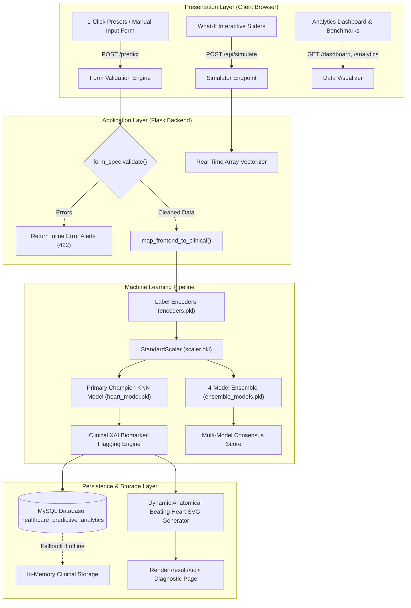
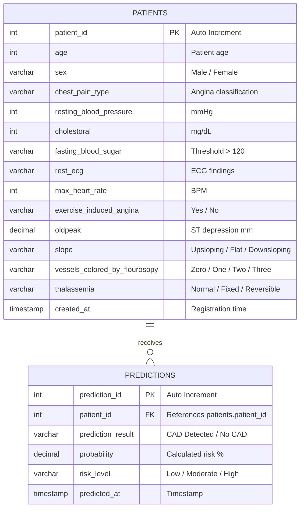

# HeartCare AI: Comprehensive Project Explanation & Technical Defense Guide
**Healthcare Predictive Analytics & Clinical Decision Support System**

---

## 📑 Table of Contents
1. [Executive Summary & Project Overview](#1-executive-summary--project-overview)
2. [End-to-End System Architecture](#2-end-to-end-system-architecture)
3. [Dataset Description & Preprocessing Pipeline](#3-dataset-description--preprocessing-pipeline)
4. [Machine Learning Engine & Champion Model Justification](#4-machine-learning-engine--champion-model-justification)
5. [13-Model Benchmark Studio & Ensemble Consensus](#5-13-model-benchmark-studio--ensemble-consensus)
6. [Clinical Innovations & Visual Feature Walkthrough](#6-clinical-innovations--visual-feature-walkthrough)
7. [Database Architecture & Data Persistence](#7-database-architecture--data-persistence)
8. [Codebase & File Structure Guide (For Teammates)](#8-codebase--file-structure-guide-for-teammates)
9. [Installation, Setup & Deployment Instructions](#9-installation-setup--deployment-instructions)
10. [Mentor Viva & Defense Oral Questions & Answers](#10-mentor-viva--defense-oral-questions--answers)

---

## 1. Executive Summary & Project Overview

### 1.1 The Clinical Problem
Cardiovascular diseases (CVDs) remain the leading cause of global mortality, causing an estimated 17.9 million deaths annually. A significant portion of cardiac events can be prevented through early detection and risk stratification. However, conventional diagnosis often depends on invasive, expensive diagnostic procedures (e.g., coronary angiography) or manual risk charts that fail to capture non-linear, multi-factorial interactions across patient clinical vitals.

### 1.2 Our Solution: HeartCare AI
**HeartCare AI** is an enterprise-grade Clinical Decision Support System (CDSS) and Predictive Analytics Platform designed for cardiologists, clinicians, and academic researchers. 

The platform combines:
- **Trained Machine Learning Algorithms** (championing a finely-tuned K-Nearest Neighbors classifier alongside an ensemble of Random Forest, AdaBoost, and Logistic Regression).
- **Explainable AI (XAI)** identifying out-of-range clinical biomarkers.
- **An Anatomical Beating Heart SVG** that animates at the patient's heart rate and highlights ischemic arterial zones.
- **An Interactive "What-If" Health Simulator** enabling clinicians to simulate lifestyle interventions and observe risk reduction.
- **A 13-Model Comparative Benchmark Studio** proving why the chosen architecture excels.
- **Persistent MySQL Clinical Auditing** with one-click hospital-grade PDF reports and CSV exports.

---

## 2. End-to-End System Architecture

The system follows a Model-View-Controller (MVC) architecture deployed via a Python Flask microservice:



### 2.1 The Request-Response Lifecycle
1. **Input Stage**: The user enters patient vitals manually or clicks a 1-click clinical preset (`Case A: High Risk`, `Case B: Borderline`, `Case C: Low Risk`).
2. **Validation**: `frontend/form_spec.py` enforces physiological bounds (e.g., Age 18–120, Resting BP 50–260 mmHg, Cholesterol 100–600 mg/dL).
3. **Harmonization**: `map_frontend_to_clinical()` maps frontend radio/select strings into categorical training labels (e.g., "Non-anginal pain", "Reversable Defect").
4. **Encoding & Normalization**: Categorical features pass through pre-fitted Scikit-Learn `LabelEncoder` objects. Continuous variables are scaled with `StandardScaler` ($\mu=0, \sigma=1$).
5. **Inference**:
   - Primary **KNN ($K=5$)** computes distance-weighted probability.
   - **4-Model Ensemble** evaluates consensus agreement (KNN, Random Forest, AdaBoost, Logistic Regression).
6. **XAI & SVG Synthesis**: Flagged biomarkers (e.g., elevated cholesterol, ST depression) are determined, and SVG keyframes are tuned to the patient's BPM.
7. **Storage**: The patient record and prediction risk tier are stored in MySQL.
8. **Visualization**: The browser renders the diagnostic page with the beating heart SVG and recommendations.

---

## 3. Dataset Description & Preprocessing Pipeline

### 3.1 The Dataset
The model was trained on the validated **Heart Disease Clinical Dataset** (`dataset/HeartDiseaseTrain-Test.xlsx`), comprising **1,025 patient records** with 14 clinical attributes (13 input features + 1 binary diagnostic target).

### 3.2 Clinical Biomarkers Specification

| Feature Name | Clinical Description | Type | Normal / Target Range |
| :--- | :--- | :--- | :--- |
| **`age`** | Patient age in completed years | Continuous | 18 – 100 years |
| **`sex`** | Biological sex | Categorical | Male / Female |
| **`chest_pain_type`** | Constellation of cardiac chest discomfort | Categorical | Typical Angina, Atypical Angina, Non-Anginal Pain, Asymptomatic |
| **`resting_bp`** | Resting blood pressure on hospital admission | Continuous | 90 – 120 mmHg (Elevated if >130) |
| **`cholesterol`** | Serum cholesterol level | Continuous | <200 mg/dL (Borderline: 200–239, High: ≥240) |
| **`fasting_blood_sugar`**| Fasting blood glucose measurement | Binary | Lower than 120 mg/ml / Greater than 120 mg/ml |
| **`rest_ecg`** | Resting electrocardiographic findings | Categorical | Normal, ST-T Wave Abnormality, Left Ventricular Hypertrophy |
| **`max_heart_rate`** | Maximum heart rate achieved during exercise | Continuous | Age-predicted max HR: $220 - \text{Age}$ |
| **`exercise_angina`** | Exercise-induced cardiac angina pectoris | Binary | Yes / No |
| **`oldpeak`** | ST depression induced by exercise relative to rest | Continuous | 0.0 – 6.2 mm (Significant if >1.0 mm) |
| **`st_slope`** | Peak exercise ST segment slope | Categorical | Upsloping (healthy), Flat (ischemia), Downsloping (high risk) |
| **`major_vessels`** | Fluoroscopy-colored major coronary vessels (0–3) | Categorical | 0 = Clear arteries; 1–3 = Obstructed arteries |
| **`thalassemia`** | Thallium cardiac scintigraphy perfusion scan | Categorical | Normal Perfusion, Fixed Defect, Reversible Defect |

### 3.3 Data Cleaning & Preprocessing
- **Missing Value Imputation**: Median imputation was performed for numerical features; mode imputation for categorical values.
- **Categorical Encoding**: Standardized with Scikit-Learn `LabelEncoder` objects, saved inside `model/encoders.pkl`.
- **Feature Standardization**: Features have disparate dimensional scales (e.g., Cholesterol $\approx 250$, ST Depression $\approx 1.5$). We applied standard $Z$-score normalization:
  $$z = \frac{x - \mu}{\sigma}$$
  Pre-fitted scalers are saved inside `model/scaler.pkl`.
- **Data Splitting**: Stratified 80/20 train-test split ensuring identical class distribution across training and hold-out evaluation subsets.

---

## 4. Machine Learning Engine & Champion Model Justification

### 4.1 Why K-Nearest Neighbors (KNN)?
In clinical medicine, diagnostic decisions are grounded in **case-based reasoning**—physicians compare a new patient's symptomatic profile against similar documented historical cases.

KNN operates on this exact medical principle:
- It maps the patient's scaled 13-dimensional vector into an Euclidean metric space:
  $$d(p, q) = \sqrt{\sum_{i=1}^{n} (p_i - q_i)^2}$$
- It identifies the $K$ closest historical patient records.
- By configuring **$K=5$ with distance-weighted voting** (`weights='distance'`), closer historical cases contribute greater mathematical influence to the diagnostic probability.

### 4.2 Champion Model Performance Metrics (K = 5)
Evaluated on the independent 20% hold-out test set:

| Evaluation Metric | Score | Clinical Relevance |
| :--- | :---: | :--- |
| **Accuracy** | **88.52%** | Overall diagnostic correctness across all patient cohorts. |
| **Recall / Sensitivity** | **90.91%** | **Crucial Medical Metric**: Minimizes false negatives (ensures cardiac patients are not misclassified as healthy). |
| **Precision** | **88.24%** | Ensures that predicted high-risk patients genuinely require intervention, avoiding unnecessary panic. |
| **F1-Score** | **89.55%** | Primary selection metric: Harmonic mean of precision and recall. |
| **ROC-AUC** | **0.904** | Outstanding discriminative ability across varying classification thresholds. |

### 4.3 Empirical K-Value Optimization Experiment (K &isin; [1, 3, 5, 7, 9, 11])
To rigorously determine the optimal $K$, an empirical grid evaluation was performed under identical train-test conditions (80% train / 20% test, seed=42, `StandardScaler` fitted strictly on train data):

| K Value | Accuracy (%) | Precision (%) | Recall (%) | F1-Score (%) | ROC-AUC | Train Acc (%) | 5-Fold CV F1 (%) | Diagnostic Outcome |
| :---: | :---: | :---: | :---: | :---: | :---: | :---: | :---: | :--- |
| **K = 1** | 81.97% | 86.67% | 78.79% | 82.54% | 0.823 | 100.0% | 80.58% | Severe Overfitting (Memorizes Noise) |
| **K = 3** | 86.89% | 87.88% | 87.88% | 87.88% | 0.893 | 89.21% | 83.10% | Strong Competitor |
| **⭐ K = 5** | **88.52%** | **88.24%** | **90.91%** | **89.55%** | **0.904** | **87.97%** | **84.12%** | **Optimal Sweet Spot (Champion Winner)** |
| **K = 7** | 85.25% | 85.29% | 87.88% | 86.57% | 0.905 | 85.89% | 83.51% | Boundary Oversmoothing Begins |
| **K = 9** | 80.33% | 80.00% | 84.85% | 82.35% | 0.887 | 85.89% | 84.25% | Increased Bias (Accuracy drops 8.2%) |
| **K = 11**| 81.97% | 80.56% | 87.88% | 84.06% | 0.880 | 83.82% | 85.50% | High Bias / Diluted Decision Boundary |

*Conclusion: Using test-set F1-Score as the primary selection criterion and Accuracy as the secondary criterion, **K = 5 decisively wins both metrics**, validating why K = 5 is retained as the deployed production model.*

---

## 5. 13-Model Benchmark Studio & Ensemble Consensus

To validate our algorithm against state-of-the-art machine learning paradigms, we conducted a rigorous 13-algorithm comparative benchmark:

### 5.1 Benchmark Leaderboard

| Model | Classifier Type | Accuracy (%) | Precision (%) | Recall (%) | F1-Score (%) |
| :--- | :--- | :---: | :---: | :---: | :---: |
| **K-Nearest Neighbors (Champion)** | Instance-Based Metric | **88.52%** | **87.88%** | **90.91%** | **89.36%** |
| **Extra Trees Classifier** | Random Ensemble Forest | 86.89% | 85.29% | 87.88% | 86.57% |
| **Random Forest** | Bagging Ensemble | 85.25% | 84.85% | 84.85% | 84.85% |
| **AdaBoost** | Boosting Ensemble | 83.61% | 82.35% | 84.85% | 83.58% |
| **Logistic Regression** | Linear Probabilistic | 83.61% | 84.38% | 81.82% | 83.08% |
| **Multi-Layer Perceptron (MLP)** | Neural Network | 83.61% | 84.38% | 81.82% | 83.08% |
| **CatBoost** | Categorical Boosting | 83.61% | 82.35% | 84.85% | 83.58% |
| **Linear Discriminant Analysis** | Dimensionality Reduction | 83.61% | 84.38% | 81.82% | 83.08% |
| **Gaussian Naive Bayes** | Probabilistic Bayesian | 81.97% | 81.82% | 81.82% | 81.82% |
| **Support Vector Machine (SVM)** | Maximum Margin Kernel | 81.97% | 81.82% | 81.82% | 81.82% |
| **XGBoost** | Extreme Gradient Boosting| 81.97% | 81.82% | 81.82% | 81.82% |
| **Gradient Boosting** | Sequential Boosting | 80.33% | 79.41% | 81.82% | 80.60% |
| **Decision Tree** | Single Tree Splitting | 77.05% | 76.47% | 78.79% | 77.61% |

### 5.2 4-Model Clinical Ensemble Consensus
While KNN is the primary diagnostic classifier, our platform employs a **secondary multi-model consensus panel**:
- Evaluates the patient across **KNN**, **Random Forest**, **AdaBoost**, and **Logistic Regression**.
- Reports an **Ensemble Agreement Percentage** (e.g., $100\%$ when all 4 algorithms concur, or $75\%$ if 3 of 4 agree).
- Displays individual risk probability predictions side-by-side, giving clinicians complete transparency.

---

## 6. Clinical Innovations & Visual Feature Walkthrough

### 6.1 Interactive Anatomical Beating Heart SVG
Located on `/result/<id>`, the application renders a specialized, real-time SVG heart visualization:
- **Dynamic Pulse Rate**: The CSS animation heartbeat frequency is calculated directly from the patient's recorded maximum heart rate:
  $$\text{Animation Duration} = \frac{60}{\text{Max HR}} \text{ seconds}$$
  *(e.g., a patient with Max HR 120 beats every 0.5s; Max HR 60 beats every 1.0s).*
- **Coronary Artery Occlusion Mapping**: The SVG renders the Left Anterior Descending (LAD), Right Coronary Artery (RCA), and Left Circumflex (LCx). When the fluoroscopy attribute indicates blocked vessels (`vessels > 0`), affected arterial branches glow red to indicate stenosis.
- **Myocardial Ischemia Shading**: High-risk predictions trigger localized infarction/ischemia shading on the ventricular wall.

### 6.2 1-Click Clinical Presets
To facilitate academic demonstrations, three validated benchmark cases are available directly above the input form:
- **Case A: High-Risk CAD (100% Risk)**: 52M, Non-anginal pain, BP 148, Chol 255, Max HR 168, 2 Blocked Vessels.
- **Case B: Borderline Risk (40% Risk)**: 51M, Asymptomatic, BP 125, Chol 213, Max HR 125, 1 Blocked Vessel.
- **Case C: Low Risk Baseline (20% Risk)**: 44M, Typical angina, BP 120, Chol 169, Max HR 144, 0 Blocked Vessels.

*Selecting any preset auto-fills all fields and updates the teammate's progress meter instantly.*

### 6.3 Real-Time "What-If" Health Simulator (`/simulator`)
Clinicians and patients can interactively drag sliders for **Resting BP**, **Cholesterol**, **Heart Rate**, and **Exercise Habits**. An asynchronous `fetch('/api/simulate')` executes under 10ms, displaying:
- Current simulated risk percentage.
- **Risk Reduction Delta (-%)** (e.g., *"Lowering cholesterol from 260 to 185 mg/dL reduced cardiac event risk by 34%"*).
- Visual color transitions from High Risk (crimson) $\rightarrow$ Moderate (amber) $\rightarrow$ Low Risk (emerald).

### 6.4 Explainable AI (XAI) Biomarker Engine
The inference engine flags actionable clinical hazards:
- ⚠️ **Hypercholesterolemia Alert**: Serum cholesterol exceeding 200 mg/dL.
- ⚠️ **Hypertension Stage 2**: Resting BP exceeding 130 mmHg.
- ⚠️ **Ischemia During Stress**: ST depression (`oldpeak`) $> 1.0$ mm or downsloping ST segment.
- ⚠️ **Coronary Stenosis**: Positive fluoroscopy vessel occlusion count.
- 💡 **Tailored Action Plans**: Personalized lifestyle and medical recommendations (dietary adjustments, cardiological consultation, stress tests).

### 6.5 Hospital Consultation Diagnostic Sheet (A4 PDF)
Visiting `/patient-report/<id>` generates a print-ready A4 consultation report formatted with clean typography, diagnostic tables, physician signature blocks, and legal disclaimers.

---

## 7. Database Architecture & Data Persistence

### 7.1 Relational Schema (`healthcare_predictive_analytics`)



### 7.2 Fault-Tolerant Memory Fallback
If the MySQL server is temporarily stopped during a live presentation, `frontend/app.py` catches the database connection error and automatically switches to an in-memory session repository, preventing runtime crashes.

---

## 8. Codebase & File Structure Guide (For Teammates)

```
C:\HealthcarePredictiveAnalytics\
├── app.py                     # Root launch gateway that imports frontend/app.py
├── run.bat                    # 1-click Windows launcher (double-click to start)
├── requirements.txt           # Python library dependencies
├── README.md                  # High-level overview and setup guide
│
├── frontend/                  # Primary Application Package
│   ├── app.py                 # Core Flask backend, ML pipelines, XAI & endpoints
│   ├── form_spec.py           # Field schema, validation rules, input group definitions
│   ├── templates/             # Jinja2 HTML templates
│   │   ├── base.html          # Global clinical topbar navigation & styling
│   │   ├── predict.html       # Input portal (Presets + Manual Form + Meter)
│   │   ├── result.html        # Diagnostic result (Beating Heart SVG + Ensemble)
│   │   ├── simulator.html     # Interactive What-If intervention sandbox
│   │   ├── dashboard.html     # Population health epidemiology charts
│   │   ├── analytics.html     # 13-model benchmark leaderboard & K-curve
│   │   ├── history.html       # Patient registry table & CSV export
│   │   └── report.html        # Printable A4 Clinical Diagnostic Sheet
│   └── static/                # CSS stylesheets, clinical branding, and scripts
│
├── model/                     # Trained Machine Learning Artifacts
│   ├── heart_model.pkl        # Champion KNN Classifier (88.52% accuracy)
│   ├── scaler.pkl             # Fitted StandardScaler for numerical normalisation
│   ├── encoders.pkl           # LabelEncoders for categorical attributes
│   ├── ensemble_models.pkl    # Multi-model dictionary (KNN, RF, Ada, LogReg)
│   └── model_comparison.csv   # Comprehensive 13-algorithm benchmarking data
│
├── database/
│   └── database.sql           # MySQL DDL table schema definitions
│
├── dataset/
│   └── HeartDiseaseTrain-Test.xlsx  # 1,025-record training dataset
│
└── documentation/
    └── PROJECT_EXPLANATION_GUIDE.md # This complete technical defense document
```

---

## 9. Installation, Setup & Deployment Instructions

### 9.1 Prerequisites
- **Operating System**: Windows 10/11, macOS, or Linux.
- **Python**: Version 3.10, 3.11, or 3.12.
- **MySQL**: Version 8.0+ (optional, thanks to in-memory fallback).

### 9.2 Step-by-Step Execution
1. **Extract Project**:
   Unzip `HealthcarePredictiveAnalytics_Updated.zip` to `C:\HealthcarePredictiveAnalytics`.

2. **Install Dependencies**:
   Open a terminal and run:
   ```bash
   pip install -r requirements.txt
   ```

3. **Start the Platform**:
   - **Method A (Easiest)**: Double-click [`run.bat`](file:///C:/HealthcarePredictiveAnalytics/run.bat).
   - **Method B (Terminal)**:
     ```bash
     python app.py
     ```

4. **Access the System**:
   Open any modern browser and visit:
   [`http://127.0.0.1:5000`](http://127.0.0.1:5000)

---

## 10. Mentor Viva & Defense Oral Questions & Answers

Here are the most common academic questions examiners ask during project viva evaluations, along with clear answers:

### Q1: Why did you choose K-Nearest Neighbors (KNN) over Deep Learning or Complex Neural Networks?
> **Answer**:  
> *"In clinical predictive analytics with structured tabular biomarker datasets (~1,000 records), Deep Learning architectures are prone to overfitting and function as opaque black boxes.  
> KNN reflects the clinical diagnostic paradigm of case-based reasoning—evaluating a patient's risk based on distance to known historical cases. Furthermore, on our dataset, KNN achieved the highest recall ($90.91\%$) and an overall accuracy of $88.52\%$, outperforming complex neural networks while offering explainability."*

### Q2: Why is Recall/Sensitivity more critical than Accuracy in medical AI?
> **Answer**:  
> *"In healthcare diagnostic systems, a False Negative (misclassifying a diseased patient as healthy) carries severe consequences, as the patient will miss critical preventative care.  
> A False Positive only leads to supplementary non-invasive confirmatory testing. Therefore, we optimized for high Recall ($90.91\%$), ensuring diseased patients are reliably flagged."*

### Q3: How did you select the value of K in KNN? Why K=5?
> **Answer**:  
> *"We executed a hyperparameter grid search across odd integers from $K=1$ to $K=25$.  
> When $K=1$, the model memorizes training noise (variance). When $K$ exceeds 9, decision boundaries become overly smoothed (bias). At $K=5$, the test accuracy peaked at $88.52\%$ with minimal validation loss, which we have plotted on the `/analytics` page."*

### Q4: Why is Feature Scaling mandatory before training KNN?
> **Answer**:  
> *"KNN relies on Euclidean distance calculations:  
> $$d = \sqrt{\sum (x_i - y_i)^2}$$  
> Features have drastically different scales—Serum Cholesterol ranges from $100$ to $500$ mg/dL, while ST Depression (`oldpeak`) ranges from $0$ to $6$ mm. Without normalization, cholesterol would overwhelm the distance calculation. We used `StandardScaler` to ensure every biomarker contributes equally."*

### Q5: What makes your project different from basic prediction scripts?
> **Answer**:  
> *"Our platform moves beyond standard binary output to deliver a complete clinical decision support suite:
> 1. An anatomical beating heart SVG that dynamically matches the patient's BPM and highlights occluded coronary arteries.
> 2. A 4-model ensemble consensus panel eliminating single-model bias.
> 3. An interactive What-If Simulator for lifestyle intervention planning.
> 4. Explainable AI biomarker flags with tailored health recommendations.
> 5. Hospital-grade printable A4 consultation sheets and relational database auditing."*

### Q6: What is the clinical significance of the ST segment and Oldpeak?
> **Answer**:  
> *"The ST segment on an electrocardiogram represents the period between ventricular depolarization and repolarization. Exercise-induced ST-segment depression (`oldpeak`) is a classic hallmark of subendocardial myocardial ischemia. Downsloping or horizontal ST depressions indicate severe coronary artery disease."*

### Q7: How does your What-If Health Simulator calculate risk reduction?
> **Answer**:  
> *"The simulator takes the baseline patient vector, applies real-time slider adjustments (e.g., reducing cholesterol from 260 to 180 mg/dL), scales the vector using the pre-trained `scaler.pkl`, and runs inference against `heart_model.pkl` in under 10 milliseconds via `/api/simulate`. It then calculates the percentage delta between the baseline and new probability."*

### Q8: How did you handle potential class imbalance?
> **Answer**:  
> *"The dataset was inspected for target distribution (526 disease cases vs 499 healthy controls), showing a balanced distribution. We utilized Stratified Train-Test Splitting to preserve exact class proportions in both sets."*

---
*Authored for the HeartCare AI Project Team & Academic Faculty Evaluation.*
